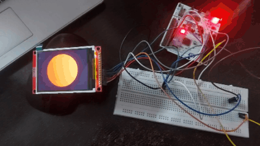

# handmade-mcu

Bare-metal Rust on an STM32F446RE with no HAL and no crates. It boots from a hand-written linker script and vector table, clocks the chip up to 180 MHz, and drives an ILI9341 SPI display using DMA. Pressing the user button toggles the on-board LED and cycles between a circle, a full-screen image, a rectangle and a sprite animation.



## Why I built this

I wanted to understand what actually happens on a microcontroller below the HAL. Every peripheral in this project is set up by writing to its registers directly, using the reference manual as the guide. There is no `cortex-m`, `cortex-m-rt`, PAC or HAL crate in the firmware, so the boot code, interrupt table and memory layout are all written by hand.

This is a learning project. The code is written to be close to the datasheet rather than nicely abstracted.

## Features

- Own linker script and startup code (copy `.data`, zero `.bss`, jump to `main`)
- Hand-written vector table with all 112 entries for the STM32F446
- System clock raised from the 16 MHz internal oscillator to 180 MHz through the PLL
- 1 ms SysTick timer used for delays
- User button on an external interrupt (EXTI + NVIC)
- SPI1 driver for an ILI9341 240x320 TFT, running at 45 MHz
- DMA transfers from a RAM buffer to SPI, 20 screen rows at a time
- Full-screen image and a 20-frame sprite animation stored in flash
- Small host tools that convert a PNG or JPG into RGB565 Rust arrays
- `cargo run` flashes the board and opens a GDB session in one step

## Hardware

- [NUCLEO-F446RE](https://www.st.com/en/evaluation-tools/nucleo-f446re.html) board (STM32F446RE, Cortex-M4F, 512 KB flash, 128 KB RAM)
- [2.8 inch SPI TFT module, 240x320, ILI9341, without touch](https://robu.in/product/2-8-inch-spi-screen-module-tft-interface-240-x-320-without-touch/)
- Jumper wires (keep them short, the SPI clock is fast)

### Wiring

| Display pin | Nucleo pin | Notes |
|---|---|---|
| VCC | 3V3 | |
| GND | GND | |
| CS | PB0 | GPIO output |
| RESET | PB2 | GPIO output |
| DC | PB1 | GPIO output, low for command, high for data |
| SDI (MOSI) | PA7 | SPI1 MOSI, AF5 |
| SCK | PB3 | SPI1 SCK, AF5 |
| LED | 3V3 | Backlight |
| SDO (MISO) | not connected | SPI is set up as transmit only |

The on-board LED (LD2, PA5) and user button (B1, PC13) are used as they are.

## How it works

### Boot

`memory.ld` describes the memory of the chip (512 KB flash at `0x0800_0000`, 128 KB RAM at `0x2000_0000`) and places the sections. The first word of flash is the initial stack pointer (top of RAM), followed by the vector table from `src/main.rs`. Every interrupt the code does not handle falls back to `default_handler` through `PROVIDE` entries in the linker script.

On reset the CPU jumps to `reset_handler`, which copies the `.data` section from flash to RAM, zeroes `.bss` and calls `main`.

### Clock

`src/clock.rs` sets the regulator to scale 1 with over-drive enabled, sets 5 flash wait states, turns on the flash prefetch and caches, and configures the PLL:

```
HSI 16 MHz / M(8) = 2 MHz
2 MHz * N(180)    = 360 MHz
360 MHz / P(2)    = 180 MHz SYSCLK
```

AHB runs at 180 MHz, APB1 at 45 MHz and APB2 at 90 MHz.

### SysTick and button

`src/systick.rs` sets SysTick to fire every 1 ms and counts milliseconds in an atomic, which `delay_ms` waits on.

`src/button.rs` routes PC13 to EXTI line 13 through SYSCFG, enables the rising edge trigger and turns on the EXTI15_10 interrupt in the NVIC. The interrupt handler clears the pending bit, toggles the LED and moves to the next thing to draw. It does not draw anything itself, the main loop picks up the change.

### Display

`src/spi.rs` sets up SPI1 as a transmit-only master at 45 MHz (APB2 90 MHz / 2), plus three GPIO pins for chip select, data/command and reset. After a hardware reset it sends the ILI9341 init sequence: software reset, sleep out, 16-bit RGB565 pixel format, memory access control and display on.

Drawing works by setting an address window on the display, sending the memory write command and then streaming pixel data. Pixels are filled into a 9600 byte buffer in RAM (20 rows of 240 pixels, 2 bytes each) and DMA2 stream 3 sends the buffer to the SPI data register. A full screen takes 16 of these transfers.

What gets drawn:

- **Circle**, calculated per pixel
- **Image**, a 240x320 picture read from flash
- **Rectangle**, calculated per pixel
- **Animation**, a 16x16 knight sprite scaled up 8 times to 128x128, 20 frames at about 10 frames per second

### Assets in flash

The image (150 KB) and the sprite sheet (10 KB) are `static` arrays, so they go into `.rodata` in flash and never take up RAM. Flash is memory mapped, so the CPU reads pixels from it directly and copies only one 9600 byte chunk at a time into the DMA buffer.

| | Used | Total |
|---|---|---|
| Flash | about 180 KB | 512 KB |
| RAM | about 10 KB plus stack | 128 KB |

### Asset tools

The `tools/` folder is a separate crate that runs on the host. It turns images into Rust source files that the firmware includes.

- `image-to-rgb565` reads `tools/image.jpg` (must be 240x320) and writes `src/image_data.rs`
- `sprite-sheet-to-rgb565` reads `tools/knight.png` (a 64x80 grid of 16x16 frames) and writes `src/sprite_data.rs`, with each frame stored as one continuous block

## Building and running

You need:

- Rust with the Cortex-M4F target: `rustup target add thumbv7em-none-eabihf`
- [probe-rs](https://probe.rs/) for flashing and the GDB server
- `gdb-multiarch`

Plug in the Nucleo over USB and run:

```sh
cargo run
```

This builds the firmware, flashes it with probe-rs and opens GDB with the core halted at reset. Type `continue` or `c` in GDB to start it.

To change the image or the sprite, replace the file in `tools/` and regenerate:

```sh
cd tools
cargo run --bin image-to-rgb565
cargo run --bin sprite-sheet-to-rgb565
```

## Known limitations

- No button debounce yet
- The CPU waits for each DMA transfer to finish instead of doing other work
- 45 MHz SPI is above the ILI9341 rated speed, it works here with short wires

## Resources

STM32F446RE and Nucleo board:

- [STM32F446 documentation page](https://www.st.com/en/microcontrollers-microprocessors/stm32f446/documentation.html), all official ST documents in one place
- [STM32F446RE datasheet](https://www.st.com/resource/en/datasheet/stm32f446re.pdf)
- [RM0390 reference manual](https://www.st.com/resource/en/reference_manual/rm0390-stm32f446xx-advanced-armbased-32bit-mcus-stmicroelectronics.pdf)
- [UM1724 Nucleo-64 user manual](https://www.st.com/resource/en/user_manual/um1724-stm32-nucleo64-boards-mb1136-stmicroelectronics.pdf)
- [PM0214 Cortex-M4 programming manual](https://www.st.com/resource/en/programming_manual/pm0214-stm32-cortexm4-mcus-and-mpus-programming-manual-stmicroelectronics.pdf)

Display:

- [ILI9341 datasheet](https://cdn-shop.adafruit.com/datasheets/ILI9341.pdf)

Linker scripts:

- [Everything You Never Wanted To Know About Linker Script](https://mcyoung.xyz/2021/06/01/linker-script/) by mcyoung
- [GNU ld linker scripts](https://sourceware.org/binutils/docs/ld/Scripts.html)
- [LLD linker script docs](https://lld.llvm.org/ELF/linker_script.html), lld follows the GNU ld manual

Tools:

- [probe-rs documentation](https://probe.rs/docs/)
